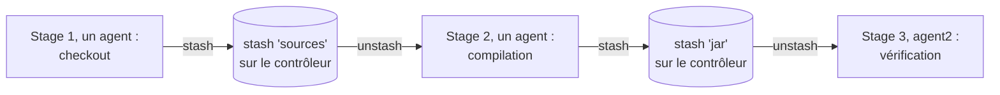

Au chapitre précédent, `agent { label 'maven' }` en tête du pipeline réservait un agent pour tout le build. Cela ne suffira plus : au prochain chapitre, quatre contrôles tourneront en même temps que la compilation, et il faudra les répartir sur les deux agents. Chaque stage va donc choisir son propre agent, et le pipeline commence par `agent none` : aucun agent pour le build entier.

## Chaque agent a son propre workspace

Un **workspace**, c'est le dossier de travail d'un job sur un agent : `/home/jenkins/agent/workspace/petclinic_main` pour la branche `main`. Chaque agent a le sien, sur son propre disque. Le schéma montre ce que cela change quand deux stages tournent sur deux agents :



Un fichier écrit dans le workspace d'`agent1` n'existe pas sur `agent2`. L'étape `stash` copie des fichiers du workspace vers le contrôleur, sous un nom ; l'étape `unstash` les recopie dans le workspace de l'agent courant, quel qu'il soit. Ces copies ne vivent que le temps du build.

| Étape | Rôle |
|---|---|
| `stash name: 'sources'` | garde tout le workspace sous le nom `sources`, sauf le dossier `.git` et les autres fichiers exclus par défaut |
| `stash name: 'jar', includes: 'target/spring-petclinic-*.jar'` | ne garde que le JAR, grâce au filtre `includes` |
| `unstash 'jar'` | recopie le JAR dans le workspace courant, au même chemin relatif : `target/…` |

⚖️ `stash` passe par le contrôleur : il convient à quelques dizaines de mégaoctets, comme le JAR de 66 Mo de PetClinic. Pour conserver un fichier après le build, on utilise `archiveArtifacts`, ou mieux, un gestionnaire d'artefacts : c'est l'objet du chapitre sur la publication.

> 📖 [`stash` et `unstash`](https://www.jenkins.io/doc/pipeline/steps/workflow-basic-steps/#stash-stash-some-files-to-be-used-later-in-the-build)

## Un seul checkout, puis des workspaces propres

Deux réglages accompagnent ce découpage.

Le premier concerne le **checkout**, la récupération du code. En pipeline déclaratif, Jenkins fait un `checkout scm` automatique chaque fois qu'un stage obtient un agent. Avec trois stages, le code serait récupéré trois fois, et rien ne garantit que les trois récupérations lisent le même commit si quelqu'un pousse entre-temps. L'option `skipDefaultCheckout()` désactive ce comportement : un premier stage récupère le code, une fois, et le partage avec `stash`.

Le second concerne le **nettoyage**. Un workspace est réutilisé d'un build à l'autre : ce qu'un build y laisse, le suivant le retrouve. `unstash` ajoute des fichiers, mais ne supprime pas ceux d'avant. Un fichier supprimé du dépôt pourrait ainsi rester dans le workspace et fausser un build. L'étape `cleanWs()` vide le workspace ; on l'appelle au début de chaque stage.

Comme chaque stage va commencer par « vider le workspace, puis reprendre tel stash », le `Jenkinsfile` définit une petite fonction Groovy, au-dessus du bloc `pipeline` :

```groovy
def fresh(String... stashes) {
  cleanWs()
  stashes.each { unstash it }
}
```

`fresh 'sources'` vide le workspace et reprend le code ; `fresh 'sources', 'jar'` reprend le code et le JAR. `String...` déclare un nombre variable d'arguments, que `each` parcourt.

> 📖 [L'option `skipDefaultCheckout`](https://www.jenkins.io/doc/book/pipeline/syntax/#options) · [Le plugin Workspace Cleanup](https://plugins.jenkins.io/ws-cleanup/)

## Forcer un stage sur agent2

Les deux agents portent les mêmes labels : un stage `agent { label 'maven' }` peut tomber sur l'un ou l'autre. Pour voir le JAR voyager à coup sûr, le troisième stage vise `agent2` par son nom. Un nom de nœud est aussi un label : `agent { label 'agent2' }` ne peut tourner que sur `agent2`.

⚖️ Viser un agent par son nom est un raccourci de démonstration. Dans un vrai pipeline, on vise un label qui décrit une capacité (`maven`, `docker`, `scan`), pour que n'importe quel agent qui la possède puisse prendre le travail, et qu'un agent en panne ne bloque rien. Ce stage disparaîtra au chapitre suivant.

## Réécrire le Jenkinsfile en trois stages

Le nouveau `Jenkinsfile` reprend votre stage de compilation, et ajoute un stage avant et un stage après. Remplacez votre fichier par celui-ci, puis complétez ses `// TODO` :

```exec "Écrire le Jenkinsfile en trois stages"
cat > ~/byte-layers/jenkins/pipeline/petclinic/Jenkinsfile <<'EOF'
// spring-petclinic : trois stages, deux agents, et stash pour passer les fichiers

// Un workspace est réutilisé d'un build à l'autre : chaque stage repart propre, puis reprend ce dont il a besoin.
def fresh(String... stashes) {
  cleanWs()
  stashes.each { unstash it }
}

pipeline {
  // TODO : aucun agent pour le pipeline entier : chaque stage choisit le sien

  options {
    buildDiscarder(logRotator(numToKeepStr: '10'))
    // TODO : désactiver le checkout automatique
  }

  environment {
    MAVEN_IMAGE = 'maven:3.9.16-eclipse-temurin-21-noble'
    NETWORK     = 'layers-jenkins'              // le réseau de la stack : reposilite et registry y sont joignables
    M2_REPO     = '/home/jenkins/caches/m2'     // hors du workspace, que le checkstyle de petclinic analyse
  }

  stages {
    stage('Récupérer le code') {
      agent { label 'maven' }
      steps {
        cleanWs()
        checkout scm
        // TODO : garder tout le workspace sous le nom sources
      }
    }

    stage('Compiler et tester') {
      agent { label 'maven' }
      steps {
        // TODO : vider le workspace et reprendre sources, avec la fonction fresh
        script {
          docker.image(env.MAVEN_IMAGE).inside("--network ${env.NETWORK}") {
            configFileProvider([configFile(fileId: 'maven-settings', variable: 'MAVEN_SETTINGS')]) {
              sh 'mvn -B -s "$MAVEN_SETTINGS" -Dmaven.repo.local=$M2_REPO package'
            }
          }
        }
        // TODO : garder seulement target/spring-petclinic-*.jar sous le nom jar
      }
      post {
        always { junit 'target/surefire-reports/*.xml' }
      }
    }

    stage('Vérifier le JAR sur agent2') {
      // TODO : ce stage tourne sur agent2, et nulle part ailleurs
      steps {
        // TODO : vider le workspace et reprendre jar
        sh 'ls -l target/'
      }
    }
  }
}
EOF
```

`buildDiscarder(logRotator(numToKeepStr: '10'))` ne garde que les dix derniers builds de chaque branche, pour ne pas remplir le disque du contrôleur.

## Pousser, et suivre le JAR

Committez et poussez :

```exec "Committer et pousser"
cd ~/byte-layers/jenkins/pipeline/petclinic && git commit -am "Split the pipeline over two agents" && git push
```

Dans **Pipeline Overview**, le build montre trois stages. Le **Console Output** dit sur quel agent tourne chacun, avec une ligne `Running on …` à l'entrée de chaque stage, et se termine sur la liste du troisième stage :

```
Running on agent2 in /home/jenkins/agent/workspace/petclinic_main
...
-rw-r--r-- 1 jenkins jenkins 65830929 Nov 28  2024 spring-petclinic-4.0.0-SNAPSHOT.jar
```

Le JAR de 66 Mo, compilé sur l'un des agents, est arrivé sur `agent2` par `unstash`. Sa date, en 2024, n'est pas une erreur : PetClinic fixe la date des fichiers du JAR, pour que deux compilations du même code produisent exactement le même fichier.

```verify
D="$HOME/byte-layers/jenkins/pipeline/petclinic"
P=$(cat "$HOME/byte-layers/jenkins/pipeline/stack/secrets/jenkins_admin_password" 2>/dev/null)
J="http://localhost:28500/job/petclinic/job/main"
F=$(git -C "$D" show origin/main:Jenkinsfile 2>/dev/null)
for p in "agent[[:space:]]+none" "skipDefaultCheckout" "stash.*sources" "stash.*jar" "agent2"; do
  if ! echo "$F" | grep -qE "$p"; then
    echo "Le Jenkinsfile poussé sur main ne contient pas « $p ». Complétez-le, committez et poussez."
    exit 1
  fi
done
R=$(curl -fsS -u "admin:$P" "$J/lastBuild/api/json?tree=result,building" 2>/dev/null)
if echo "$R" | grep -q '"building":true'; then echo "Le build est en cours : attendez qu'il se termine."; exit 1; fi
if ! echo "$R" | grep -q '"result":"SUCCESS"'; then echo "Le dernier build de main n'a pas réussi. Lisez son Console Output."; exit 1; fi
if ! curl -fsS -u "admin:$P" "$J/lastBuild/consoleText" 2>/dev/null | grep -q "spring-petclinic-4.0.0-SNAPSHOT.jar"; then
  echo "Le build a réussi, mais le JAR n'apparaît pas dans la liste du stage sur agent2 : vérifiez fresh 'jar'."
  exit 1
fi
echo "Le JAR a voyagé jusqu'à agent2."
```

```hint
Si le troisième stage échoue sur `No such saved stash ‘jar’`, le stage de compilation ne l'a pas créé : vérifiez la ligne `stash name: 'jar', includes: …` et son filtre.
```

````solution
```groovy
pipeline {
  agent none

  options {
    buildDiscarder(logRotator(numToKeepStr: '10'))
    skipDefaultCheckout()
  }
  // environment : inchangé

  stages {
    stage('Récupérer le code') {
      agent { label 'maven' }
      steps {
        cleanWs()
        checkout scm
        stash name: 'sources'
      }
    }

    stage('Compiler et tester') {
      agent { label 'maven' }
      steps {
        fresh 'sources'
        script {
          // inchangé : docker.image(...).inside(...) { configFileProvider(...) { sh 'mvn ...' } }
        }
        stash name: 'jar', includes: 'target/spring-petclinic-*.jar'
      }
      post {
        always { junit 'target/surefire-reports/*.xml' }
      }
    }

    stage('Vérifier le JAR sur agent2') {
      agent { label 'agent2' }
      steps {
        fresh 'jar'
        sh 'ls -l target/'
      }
    }
  }
}
```
Le fichier complet est [`solution/03-stash/Jenkinsfile`](../../solution/03-stash/Jenkinsfile).
````
