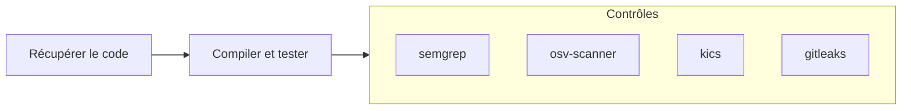
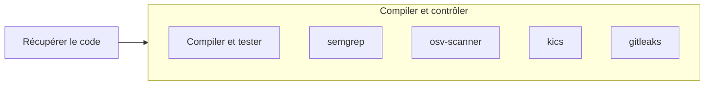

Regardez les commandes des quatre scanners : aucune ne lit le JAR. Semgrep, KICS et gitleaks lisent les fichiers du dépôt, et osv-scanner lit le `pom.xml`. Ils n'ont donc aucune raison d'attendre la fin de la compilation. Dans ce chapitre, vous réorganisez le pipeline pour qu'ils tournent en même temps qu'elle, et vous mesurez ce que vous y gagnez.

Jusqu'ici, chaque étape avait son fichier de départ. Celle-ci n'en a pas : vous connaissez maintenant la structure du `Jenkinsfile`, et vous la réorganisez vous-même à partir de la cible et de quelques repères.

## Mesurer la durée d'un build avant le changement

Avant de modifier quoi que ce soit, ouvrez le dernier build de `main` et notez sa durée, affichée en haut de sa page. Lancez-en un second avec **Build Now** si le premier comprenait le téléchargement des images des scanners : la mesure doit porter sur un build où tout est déjà en cache.

## La cible : la compilation devient une branche

Le pipeline passe de trois stages à deux. Le stage `Compiler et tester` entre dans le bloc `parallel`, à côté des quatre scanners, et le stage parent change de nom pour dire ce qu'il fait désormais :

Avant, les contrôles attendent la fin de la compilation :



Après, ils tournent avec elle :



🚧 **À vous de jouer**, dans votre éditeur :

1. renommez le stage `Contrôles` en `Compiler et contrôler` ;
2. déplacez tout le stage `Compiler et tester`, avec son `agent`, ses `steps` et son `post`, à l'intérieur du bloc `parallel`, en première position ;
3. vérifiez que chaque accolade ouverte est refermée : le stage déplacé prend un niveau d'indentation de plus.

Rien d'autre ne change. Le `stash name: 'jar'` reste dans la branche de compilation : les stages qui suivront le bloc `parallel`, aux chapitres suivants, le trouveront, puisqu'un stage ne commence qu'une fois le précédent terminé, toutes branches comprises.

Committez et poussez :

```exec "Committer et pousser"
cd ~/byte-layers/jenkins/pipeline/petclinic && git commit -am "Run the checks while compiling" && git push
```

> **🧪 Manip — mesurer le gain**
>
> 1. Attendez la fin du build, puis relevez sa durée.
> 2. Comparez-la avec celle que vous avez notée.
> 3. Dans **Pipeline Overview**, regardez quelle branche finit en dernier.
>
> *Observé à l'écriture de ce lab, caches remplis : 58 s avant, 37 s après. La branche de compilation est la plus longue ; les scanners finissent pendant qu'elle tourne. Le build dure désormais à peu près le checkout plus la compilation : les contrôles ne coûtent presque plus rien en temps.*

```verify
D="$HOME/byte-layers/jenkins/pipeline/petclinic"
P=$(cat "$HOME/byte-layers/jenkins/pipeline/stack/secrets/jenkins_admin_password" 2>/dev/null)
J="http://localhost:28500/job/petclinic/job/main"
F=$(git -C "$D" show origin/main:Jenkinsfile 2>/dev/null)
C=$(curl -fsS -u "admin:$P" "$J/lastBuild/consoleText" 2>/dev/null)
if ! echo "$C" | grep -q "{ (Branch: Compiler et tester)"; then
  echo "Dans le dernier build, « Compiler et tester » n'est pas une branche du bloc parallel. Vérifiez qu'il est bien à l'intérieur de parallel { … }, puis poussez."
  exit 1
fi
R=$(curl -fsS -u "admin:$P" "$J/lastBuild/api/json?tree=result,building")
if echo "$R" | grep -q '"building":true'; then echo "Le build est en cours : attendez qu'il se termine."; exit 1; fi
if echo "$R" | grep -q '"result":"FAILURE"'; then echo "Le dernier build a échoué. Lisez son Console Output."; exit 1; fi
echo "La compilation et les contrôles tournent en même temps."
```

```hint
Si Jenkins refuse le fichier avec `WorkflowScript: … Expected a stage` ou une erreur d'accolade, ouvrez le fichier dans un éditeur qui surligne les accolades correspondantes, et comparez la structure avec le schéma « Après ».
```

````solution
```groovy
    stage('Compiler et contrôler') {
      parallel {
        stage('Compiler et tester') {
          agent { label 'maven' }
          steps {
            fresh 'sources'
            script {
              docker.image(env.MAVEN_IMAGE).inside("--network ${env.NETWORK}") {
                configFileProvider([configFile(fileId: 'maven-settings', variable: 'MAVEN_SETTINGS')]) {
                  sh 'mvn -B -s "$MAVEN_SETTINGS" -Dmaven.repo.local=$M2_REPO package'
                }
              }
            }
            stash name: 'jar', includes: 'target/spring-petclinic-*.jar'
          }
          post {
            always { junit 'target/surefire-reports/*.xml' }
          }
        }

        stage('SAST : semgrep') {
          // inchangé
        }
        // les trois autres branches : inchangées
      }
    }
```
Le fichier complet est [`solution/04-parallel-with-build/Jenkinsfile`](../../solution/04-parallel-with-build/Jenkinsfile).
````

⚖️ Un bloc `parallel` laisse ses branches aller au bout, même si l'une échoue : les rapports des scanners restent lisibles quand un test casse. L'option `failFast true`, placée dans le stage parent, arrête au contraire toutes les branches dès le premier échec. Elle économise des minutes de calcul sur un gros projet, au prix des rapports des autres branches.

> 📖 [L'option `failFast` et `parallelsAlwaysFailFast`](https://www.jenkins.io/doc/book/pipeline/syntax/#parallel)
