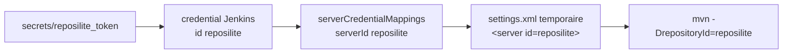

Pour l'instant, le JAR disparaît avec le build. Or c'est lui que d'autres vont utiliser : l'image Docker du chapitre suivant, une équipe qui en dépend, un déploiement. Il doit donc être rangé dans un dépôt d'artefacts, avec une version, pour qu'on puisse le retrouver plus tard.

## Publier le JAR qui a passé les tests

Avec Maven, la commande habituelle de publication est `mvn deploy`. Elle reprend tout le cycle de construction : compilation, tests, puis publication. Le JAR publié serait donc une seconde compilation, et non celui que les tests ont validé. Le lab publie à la place le fichier exact produit par le stage de compilation, avec le but `deploy:deploy-file` du plugin de publication de Maven :

```bash
mvn -B -s "$MAVEN_SETTINGS" -Dmaven.repo.local=$M2_REPO deploy:deploy-file \
  -Dfile=$(ls target/spring-petclinic-*.jar) -DpomFile=pom.xml \
  -DrepositoryId=reposilite -Durl=http://reposilite:8080/snapshots
```

| Option | Rôle |
|---|---|
| `deploy:deploy-file` | publier un fichier déjà construit, sans reconstruire le projet |
| `-Dfile=$(ls target/spring-petclinic-*.jar)` | le JAR, repris du stash `jar`. Le `ls` trouve son nom, qui contient la version |
| `-DpomFile=pom.xml` | le `pom.xml`, d'où Maven lit les coordonnées du JAR : son groupe, son nom et sa version |
| `-DrepositoryId=reposilite` | l'identifiant du dépôt cible. Maven cherche dans ses réglages un bloc `<server>` du même identifiant, qui porte l'utilisateur et le mot de passe |
| `-Durl=http://reposilite:8080/snapshots` | le dépôt `snapshots` de Reposilite |

La version de PetClinic est `4.0.0-SNAPSHOT`. Le suffixe **SNAPSHOT** est la convention Maven pour une version en cours de développement. Elle va dans un dépôt dédié, `snapshots`, où chaque publication est gardée sous un nom horodaté, comme `spring-petclinic-4.0.0-20261113.002310-1.jar`. Une version sans suffixe, comme `4.0.0`, est une **release** : elle va dans le dépôt `releases`, et ne se publie qu'une fois.

> 📖 [`deploy:deploy-file`](https://maven.apache.org/plugins/maven-deploy-plugin/deploy-file-mojo.html) · [Les versions SNAPSHOT](https://maven.apache.org/guides/getting-started/index.html#what-is-a-snapshot-version)

## Ne publier que depuis main

Le job multibranch construit toutes les branches avec le même `Jenkinsfile`. Si chaque branche publiait, la moindre branche de travail, pas encore relue, remplacerait le dernier `4.0.0-SNAPSHOT` que les autres utilisent. La directive `when` d'un stage pose une condition : si elle est fausse, le stage est sauté, et le build continue.

```groovy
stage('Publier le JAR') {
  when { beforeAgent true; branch 'main' }   // ce stage ne tourne que sur la branche main
  agent { label 'maven' }
  steps { ... }
}
```

`branch 'main'` compare le nom de la branche construite avec `main`. Par défaut, Jenkins attribue d'abord un agent au stage, puis évalue la condition : un stage sauté aurait quand même attendu un exécuteur libre. `beforeAgent true` inverse l'ordre, et un stage sauté n'occupe plus aucun agent. Il vaut mieux l'ajouter à chaque `when` d'un stage qui a son propre agent.

> 📖 [La directive `when`](https://www.jenkins.io/doc/book/pipeline/syntax/#when)

## Ajouter le stage de publication

Le fichier se termine aujourd'hui par trois accolades fermantes, chacune sur sa ligne : celle du stage `Compiler et contrôler` (4 espaces d'indentation), celle du bloc `stages` (2 espaces), et celle de `pipeline`. Collez le nouveau stage **entre la première et la deuxième**, juste avant l'accolade de `stages` :

```groovy
    }                      // fin du stage Compiler et contrôler

    // <- le nouveau stage se colle ici
  }                        // fin de stages
}                          // fin de pipeline
```

Collez ce stage à cet endroit, puis complétez ses `// TODO` :

```groovy
    stage('Publier le JAR') {
      // TODO : seulement sur la branche main, condition évaluée avant d'attribuer l'agent
      agent { label 'maven' }
      steps {
        // TODO : vider le workspace, puis reprendre sources et jar
        script {
          docker.image(env.MAVEN_IMAGE).inside("--network ${env.NETWORK}") {
            configFileProvider([configFile(fileId: 'maven-settings', variable: 'MAVEN_SETTINGS')]) {
              // publie le JAR qui a passé les tests, sans le recompiler
              sh '''
                mvn -B -s "$MAVEN_SETTINGS" -Dmaven.repo.local=$M2_REPO deploy:deploy-file \
                  -Dfile=$(ls target/spring-petclinic-*.jar) -DpomFile=pom.xml \
                  -DrepositoryId=reposilite -Durl=http://reposilite:8080/snapshots
              '''
            }
          }
        }
      }
    }
```

Les trois guillemets simples, `'''`, ouvrent une chaîne sur plusieurs lignes, dont Groovy ne remplace aucune variable : le shell de l'agent s'en charge. Le stage a besoin des deux stash : `jar` pour le fichier, `sources` pour le `pom.xml`.

Committez et poussez :

```exec "Committer et pousser"
cd ~/byte-layers/jenkins/pipeline/petclinic && git commit -am "Publish the JAR from main" && git push
```

## Le build échoue : Reposilite refuse Jenkins

Ce build va échouer, et c'est attendu. Ouvrez le **Console Output** du stage `Publier le JAR` :

⚠️ **Piège — la publication est refusée.**
- *Symptôme :* le stage s'arrête sur `Could not transfer artifact org.springframework.samples:spring-petclinic:jar:4.0.0-… from/to reposilite (http://reposilite:8080/snapshots): status code: 401, reason phrase: Unauthorized (401)`.
- *Cause :* le code HTTP 401 veut dire « qui êtes-vous ? ». Reposilite laisse tout le monde lire, mais n'accepte une publication qu'avec un jeton. Maven n'en a pas envoyé : le fichier de réglages `maven-settings` déclare bien que le serveur `reposilite` utilise le credential `reposilite`, mais ce credential n'existe pas encore dans Jenkins.
- *Correctif :* déclarer le credential `reposilite` dans JCasC, comme vous l'avez fait pour `agent2`.

Ouvrez `stack/jenkins/casc/jenkins.yaml`. Dans la section `unclassified`, le fichier de réglages Maven fait déjà le lien entre le serveur Maven et le credential Jenkins :

```yaml
          serverCredentialMappings:
            - serverId: reposilite
              credentialsId: reposilite
```

Au moment du build, `configFileProvider` lit ce lien, et écrit dans le `settings.xml` temporaire un bloc `<server>` avec l'identifiant `reposilite`, l'utilisateur et le mot de passe du credential. C'est ce bloc que `-DrepositoryId=reposilite` désigne. Le schéma suit le mot de passe, du secret jusqu'à Maven :



Le mot de passe n'apparaît ni dans le `Jenkinsfile` ni dans le journal : Jenkins le masque par des `****`.

Le credential, lui, se déclare dans la section `credentials`, à côté de celui de Gitea. Côté Reposilite, le jeton s'appelle `jenkins`, et son secret est celui du fichier `secrets/reposilite_token` : le service `reposilite` de `compose.yaml` le crée au démarrage avec l'option `--token jenkins:…`.

🚧 **À compléter** dans `stack/jenkins/casc/jenkins.yaml`, à la place du second `# TODO` :

```yaml
credentials:
  system:
    domainCredentials:
      - credentials:
          - usernamePassword:
              scope: GLOBAL
              id: gitea
              description: "Gitea — compte learner"
              username: learner
              password: "${gitea_password}"
          # TODO (chapitre « Publier le JAR ») : le credential reposilite, utilisateur jenkins, mot de passe ${reposilite_token}
```

Rechargez ensuite la configuration, comme pour `agent2` : **Administrer Jenkins › Configuration as Code**, bouton ↻ **Reload configuration**. Le credential apparaît dans **Administrer Jenkins › Credentials**.

Relancez enfin le build de `main` avec **Build Now**. Le stage de publication se termine cette fois sur :

```
[INFO] Uploaded to reposilite: http://reposilite:8080/snapshots/org/springframework/samples/spring-petclinic/4.0.0-SNAPSHOT/spring-petclinic-4.0.0-20261113.002310-1.jar (66 MB at 58 MB/s)
[INFO] BUILD SUCCESS
```

Ouvrez http://localhost:28540, puis le dépôt **snapshots** et le chemin `org/springframework/samples/spring-petclinic/4.0.0-SNAPSHOT` : le JAR y est, avec son `pom` et les sommes de contrôle que Maven calcule pour chaque fichier.

> 📖 [Les credentials dans JCasC](https://github.com/jenkinsci/configuration-as-code-plugin/blob/master/demos/credentials/README.md) · [Les jetons de Reposilite](https://reposilite.com/guide/tokens)

```verify
P=$(cat "$HOME/byte-layers/jenkins/pipeline/stack/secrets/jenkins_admin_password" 2>/dev/null)
J="http://localhost:28500/job/petclinic/job/main"
if ! curl -fsS -u "admin:$P" "http://localhost:28500/credentials/store/system/domain/_/api/json?tree=credentials%5Bid%5D" 2>/dev/null | grep -q '"id":"reposilite"'; then
  echo "Le credential reposilite n'existe pas dans Jenkins. Complétez jenkins.yaml, puis rechargez la configuration."
  exit 1
fi
R=$(curl -fsS -u "admin:$P" "$J/lastBuild/api/json?tree=result,building")
if echo "$R" | grep -q '"building":true'; then echo "Le build est en cours : attendez qu'il se termine."; exit 1; fi
if ! curl -fsS -u "admin:$P" "$J/lastBuild/consoleText" 2>/dev/null | grep -q "Uploaded to reposilite: .*spring-petclinic-4.0.0-.*\.jar"; then
  echo "Le dernier build de main n'a pas publié le JAR. Relancez-le avec Build Now après avoir rechargé la configuration."
  exit 1
fi
if ! curl -fsS "http://localhost:28540/api/maven/details/snapshots/org/springframework/samples/spring-petclinic/4.0.0-SNAPSHOT" 2>/dev/null | grep -q '\.jar"'; then
  echo "Reposilite ne contient pas le JAR dans snapshots."
  exit 1
fi
echo "Le JAR testé est publié dans Reposilite."
```

```hint
Si le rechargement de la configuration échoue avec `Unknown property` ou une erreur d'indentation, alignez le nouveau `- usernamePassword:` exactement sous celui de Gitea.
```

````solution
```yaml
credentials:
  system:
    domainCredentials:
      - credentials:
          - usernamePassword:
              scope: GLOBAL
              id: gitea
              description: "Gitea — compte learner"
              username: learner
              password: "${gitea_password}"
          - usernamePassword:
              scope: GLOBAL
              id: reposilite
              description: "Reposilite — jeton jenkins"
              username: jenkins
              password: "${reposilite_token}"
```
Le stage complet :
```groovy
    stage('Publier le JAR') {
      when { beforeAgent true; branch 'main' }
      agent { label 'maven' }
      steps {
        fresh 'sources', 'jar'
        script {
          // inchangé : docker.image(...).inside(...) { configFileProvider(...) { sh '''mvn ... deploy:deploy-file ...''' } }
        }
      }
    }
```
Les fichiers complets sont [`solution/stack/jenkins/casc/jenkins.yaml`](../../solution/stack/jenkins/casc/jenkins.yaml) et [`solution/05-publish-jar/Jenkinsfile`](../../solution/05-publish-jar/Jenkinsfile).
````

## Vérifier la condition sur une branche de travail

Il reste à constater que `when` protège bien la publication. Cette branche servira aussi au chapitre sur les pull requests. Créez une branche de travail, `feature/welcome`, qui change le message d'accueil de PetClinic :

```exec "Créer la branche feature/welcome"
cd ~/byte-layers/jenkins/pipeline/petclinic && git switch -c feature/welcome
```

Ouvrez `src/main/resources/messages/messages.properties`, et remplacez la ligne `welcome=Welcome` par :

```properties
welcome=Welcome to the byte_layers clinic
```

Committez, puis poussez la branche. L'option `-u` relie votre branche locale à celle de Gitea, pour que les prochains `git push` sachent où aller :

```exec "Committer et pousser la branche"
cd ~/byte-layers/jenkins/pipeline/petclinic && git commit -am "Change the welcome message" && git push -u origin feature/welcome
```

Le webhook signale une nouvelle branche : un sous-job `feature/welcome` apparaît dans `spring-petclinic`, et son premier build démarre. Il compile, teste et lance les contrôles, puis son journal dit :

```
Stage "Publier le JAR" skipped due to when conditional
```

Dans **Pipeline Overview**, le stage apparaît grisé. Revenez enfin sur `main`, où se poursuit le lab :

```exec "Revenir sur main"
cd ~/byte-layers/jenkins/pipeline/petclinic && git switch main
```

```verify
P=$(cat "$HOME/byte-layers/jenkins/pipeline/stack/secrets/jenkins_admin_password" 2>/dev/null)
J="http://localhost:28500/job/petclinic/job/feature%252Fwelcome"
R=$(curl -fsS -u "admin:$P" "$J/lastBuild/api/json?tree=result,building" 2>/dev/null) || { echo "Le sous-job feature/welcome n'existe pas. Poussez la branche avec git push -u origin feature/welcome."; exit 1; }
if echo "$R" | grep -q '"building":true'; then echo "Le build de feature/welcome est en cours : attendez qu'il se termine."; exit 1; fi
if ! curl -fsS -u "admin:$P" "$J/lastBuild/consoleText" 2>/dev/null | grep -q 'Stage "Publier le JAR" skipped due to when conditional'; then
  echo "Sur feature/welcome, le stage de publication n'a pas été sauté : vérifiez when { branch 'main' }."
  exit 1
fi
if [ "$(git -C "$HOME/byte-layers/jenkins/pipeline/petclinic" branch --show-current)" != "main" ]; then
  echo "La publication est bien sautée, mais revenez sur main avec git switch main."
  exit 1
fi
echo "La branche de travail ne publie pas : seule main publie."
```
