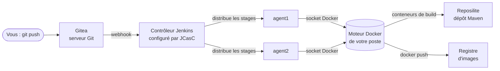
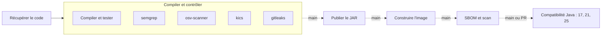

Dans ce lab, vous construisez la chaîne d'intégration continue d'une vraie application Java, [Spring PetClinic](https://github.com/spring-projects/spring-petclinic), l'application de démonstration du framework Spring Boot. Vous partez d'une stack Jenkins déjà configurée, et vous écrivez son `Jenkinsfile` étape par étape, jusqu'à un pipeline qui compile, teste, contrôle la sécurité du code, publie ce qu'il produit, et ne publie que depuis la branche principale.

Vous complétez vous-même les blancs marqués `TODO`, dans la configuration et dans le `Jenkinsfile`. Le bouton de vérification contrôle le résultat, les indices se dévoilent un par un, et la solution reste en dernier recours.

**Niveau** : intermédiaire. Vous savez ce que sont un contrôleur Jenkins, un agent et un label, et vous avez déjà écrit un `Jenkinsfile` déclaratif avec `pipeline`, `agent`, `stages`, `stage` et `steps`. Vous avez vu `stash` et l'outil Docker de Jenkins au moins une fois. Vous savez lancer un projet Compose, et créer une branche, committer et pousser avec Git. Vous n'avez besoin de connaître ni Java ni Maven : chaque commande propre à Java est expliquée. Ce qui est nouveau est guidé pas à pas, en particulier **JCasC**, le **multibranch**, `parallel`, `when` et `matrix`.

**Durée** : environ 7 heures, à faire en plusieurs fois (voir « Faire une pause » plus bas).

**Ce qu'il faut** :

- Docker et Compose qui répondent. Le lab a été validé avec Docker Desktop sur un Mac à processeur ARM ; toutes ses images existent aussi pour les processeurs Intel et AMD. Docker Desktop est payant dans les grandes entreprises : vérifiez ses conditions, ou utilisez Docker Engine sous Linux ;
- environ **5 Go de mémoire** pour Docker au moment le plus chargé, et **15 Go d'espace disque** pour les images et les caches ;
- les ports **28500**, **28530**, **28540** et **28550** libres ;
- un accès à internet : images Docker, Maven Central, règles de semgrep ;
- un terminal bash ou zsh (sous Windows, celui de WSL), `git`, `curl` et `openssl`, un éditeur de texte et un navigateur.

Tout ce que vous créez porte le préfixe `layers-jenkins`, et vos fichiers vivent dans `~/byte-layers/jenkins/pipeline`.

**Si un téléchargement échoue avec `429 Too Many Requests`** : Docker Hub limite les téléchargements anonymes par adresse IP. Attendez, ou créez un compte gratuit sur Docker Hub et lancez `docker login`.

## La stack que vous allez démarrer

Un pipeline réel ne vit pas seul : il lit le code dans un serveur Git, il tourne sur des machines dédiées, et il dépose ce qu'il produit dans un dépôt d'artefacts. La stack du lab reproduit ces quatre rôles avec des conteneurs, sur votre poste. Le schéma montre qui parle à qui :



Chaque élément a une raison d'être :

| Élément | Pourquoi il est là |
|---|---|
| Gitea | un serveur Git léger, rempli au démarrage avec PetClinic. Vous y poussez vos branches, et il prévient Jenkins à chaque push par un **webhook**. Il remplace GitHub ou GitLab, sans compte à créer |
| Le contrôleur Jenkins | il reçoit les événements, lit le `Jenkinsfile` et distribue le travail. Il ne lance aucun build lui-même |
| `agent1` et `agent2` | les deux agents qui exécutent les stages. À deux, ils peuvent travailler en même temps |
| Le moteur Docker | les agents s'en servent pour lancer Maven et les scanners dans des conteneurs : aucun outil n'est installé sur les agents |
| Reposilite et le registre | le gestionnaire d'artefacts : Reposilite reçoit le JAR, le registre reçoit l'image |

⚖️ **On simule un gestionnaire d'artefacts.** Reposilite et le registre d'images sont deux produits légers, choisis pour tenir sur un poste : moins de 150 Mo de mémoire à eux deux. En entreprise, on trouve plus souvent un seul produit qui gère les JAR, les images et le cache des dépôts publics, comme Sonatype Nexus ou JFrog Artifactory, ou Harbor pour les seules images. Ils demandent chacun 2 Go de mémoire ou plus. Ce que vous faites ici, publier par Maven et pousser par Docker, reste identique avec eux.

⚖️ Ici, les deux agents sont deux conteneurs sur votre poste, qui partagent son processeur, sa mémoire et son moteur Docker. En entreprise, chaque agent est une machine à part, ou un conteneur créé à la demande sur un cluster : deux agents y doublent vraiment la capacité de calcul. Sur votre poste, ce qui tourne en parallèle reste limité par le nombre de cœurs et la mémoire.

## Le pipeline que vous allez écrire

Le `Jenkinsfile` grandit de chapitre en chapitre. Voici le pipeline final, de gauche à droite : les stages en pointillés ne tournent que sous condition.



Voici, morceau par morceau, le chapitre qui l'ajoute :

| Morceau du pipeline | Chapitre |
|---|---|
| compiler et lancer les tests unitaires dans un conteneur Maven | Écrire le premier Jenkinsfile |
| passer les fichiers d'un agent à l'autre avec `stash` | Répartir le travail sur deux agents |
| quatre contrôles de sécurité en parallèle de la compilation | Lancer quatre contrôles en parallèle |
| publier le JAR, depuis `main` seulement | Publier le JAR dans Reposilite |
| construire et pousser l'image | Construire et pousser l'image |
| produire la SBOM de l'image et y chercher les vulnérabilités | Produire la SBOM et scanner l'image |
| une pull request, une fusion, des builds cassés exprès | Pull request, fusion et builds cassés exprès |
| rejouer les tests sur Java 17, 21 et 25 | Tester trois versions de Java avec une matrice |

## Les fichiers et le nettoyage

Vos fichiers vivent dans `~/byte-layers/jenkins/pipeline`. Le dossier `stack/` contient la stack, et le dossier `petclinic/` votre copie du dépôt Git. Le dernier chapitre arrête la stack, supprime ses volumes et ses images, puis ce dossier.

## Faire une pause

La stack garde tout dans des volumes Docker : la configuration et les builds de Jenkins, le dépôt Gitea, les JAR, les images et les caches. Pour vous arrêter entre deux séances, arrêtez les conteneurs sans les supprimer, depuis `~/byte-layers/jenkins/pipeline/stack` :

```bash
docker compose stop
```

Pour reprendre, relancez-les depuis le même dossier ; tout est là où vous l'avez laissé :

```bash
docker compose up -d
```

⚠️ N'utilisez pas `docker compose down -v` avant le dernier chapitre : l'option `-v` supprime les volumes, donc tout votre travail dans Jenkins et Gitea.

```ack
J'ai compris ce que fait la stack, et où vivent mes fichiers
```
